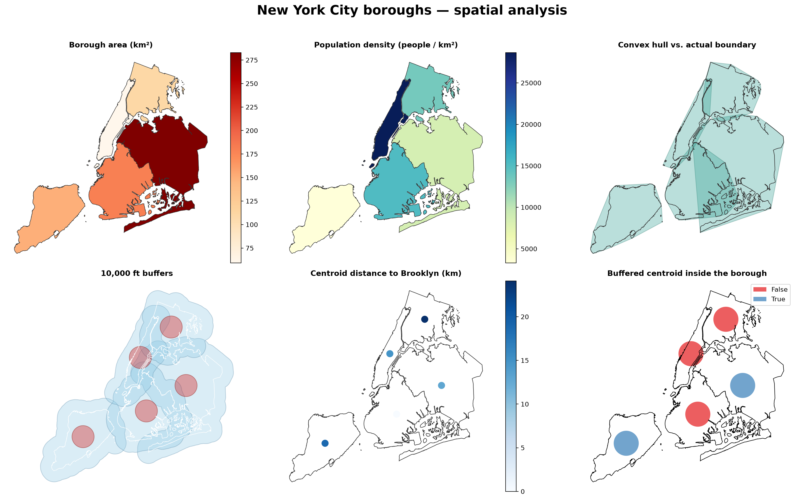
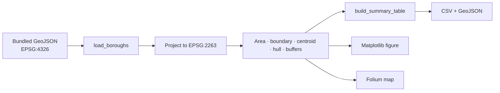

<div align="center">

# 🗽 NYC Boroughs — GIS Analysis

**Five boroughs, one reproducible spatial-analysis pipeline.**

A GeoPandas project that loads New York City borough boundaries, projects them to the
correct local CRS, measures area and perimeter, builds 10,000-ft buffers, compares convex
hulls, and exports a chart, a CSV, a GeoJSON and an interactive Folium map.

[](https://www.python.org/)
[](https://geopandas.org/)
[](https://matplotlib.org/)
[](https://python-visualization.github.io/folium/)
[](#-testing)
[](LICENSE)

[**Open the project**](https://github.com/BennyLinntu/GIS) ·
[**Report a bug**](https://github.com/BennyLinntu/GIS/issues)

</div>

---

## 🖼️ Preview

<div align="center">
  
  <p><em>Area, density, convex hull, buffers, centroid distance and containment — one figure.</em></p>
</div>

<p align="center">
  <a href="my_map.html"><strong>Open the interactive map →</strong></a>
</p>

---

## ✨ What it computes

| Metric | Method |
|---|---|
| 📐 **Area** | Projected polygon area in ft², converted to km² |
| 📏 **Boundary length** | Projected perimeter in feet, converted to km |
| 🧭 **Centroid** | Geometric centroid of each borough |
| 🫧 **10,000-ft buffer** | Planar buffer around each borough |
| 🎯 **Centroid buffer** | 10,000-ft buffer around each centroid |
| ↔️ **Distance to Brooklyn** | Centroid-to-centroid distance in km |
| 🔗 **Buffer intersection** | Does a borough's buffer touch Brooklyn? |
| 📦 **Containment** | Is the buffered centroid still inside the borough? |
| 🧩 **Convex hull ratio** | Hull area ÷ borough area; higher means a more irregular shape |
| 👥 **Density** | 2020 Census population ÷ area in km² |

### Why project first?

The bundled GeoJSON is in **EPSG:4326** (degrees) for portability. The analysis converts it
to **EPSG:2263** — NAD83 / New York Long Island, measured in **US survey feet** — so that
distance, area and buffer operations are meaningful. Buffering or measuring in degrees
would produce badly distorted numbers.

---

## 🚀 Quick start

```bash
git clone https://github.com/BennyLinntu/GIS.git
cd GIS

python -m venv .venv
# Windows
.\.venv\Scripts\Activate.ps1
# macOS / Linux
# source .venv/bin/activate

pip install -r requirements.txt
python gis_analysis.py
```

No internet connection is needed: the borough GeoJSON is bundled in [`data/`](data/).

### Generated files

| File | What it is |
|---|---|
| `borough_statistics.csv` | Sorted summary table |
| `borough_statistics.geojson` | Clean GeoJSON with derived metrics |
| `nybb_analysis.png` | Six-panel static figure |
| `my_map.html` | Layered interactive Leaflet/Folium map |

### CLI options

```bash
python gis_analysis.py --help
python gis_analysis.py --open-browser      # open the HTML map
python gis_analysis.py --show-plots        # keep Matplotlib windows open
python gis_analysis.py --no-map            # skip Folium
python gis_analysis.py --output-dir output
```

---

## 📊 Results

The bundled snapshot produces:

| Borough | Area (km²) | Boundary (km) | Density (people/km²) | To Brooklyn (km) |
|---|---:|---:|---:|---:|
| Queens | 282.92 | 266.87 | 8,502 | 12.96 |
| Brooklyn | 180.00 | 218.90 | 15,201 | 0.00 |
| Staten Island | 150.88 | 98.14 | 3,286 | 18.80 |
| Bronx | 110.28 | 138.05 | 13,354 | 24.08 |
| Manhattan | 59.13 | 107.30 | 28,653 | 14.81 |

- **Largest:** Queens
- **Smallest:** Manhattan
- **Densest:** Manhattan
- **Total:** 783.21 km² · 8,804,190 people

Numbers can shift slightly with different boundary vintages or simplification tolerances.

---

## 🧠 How the code is organized



The pipeline is split into small pure functions so each stage can be tested:

- `load_boroughs()` — load, reproject and derive columns
- `build_summary_table()` — sorted analysis table
- `print_analysis()` — terminal summary
- `create_static_figure()` — six-panel PNG
- `create_interactive_map()` — layered HTML map
- `write_outputs()` — CSV, GeoJSON and figure
- `main()` — CLI orchestration

---

## 🧪 Testing

```bash
python -m unittest discover -s tests -v
```

7 tests cover:

- ✅ five boroughs loaded in EPSG:2263
- ✅ known area values for Queens, Brooklyn and Manhattan
- ✅ distance / density / convex-hull columns
- ✅ sorted summary table
- ✅ buffer and containment flags
- ✅ CSV, PNG and GeoJSON exports
- ✅ the interactive map contains all layers

---

## 📁 Project structure

```text
GIS/
├── gis_analysis.py              # analysis pipeline + CLI
├── data/
│   ├── nyc_boroughs.geojson     # bundled boundaries (simplified)
│   └── README.md                # source + attribution
├── tests/test_analysis.py       # 7 offline tests
├── borough_statistics.csv       # generated summary
├── borough_statistics.geojson   # generated enriched data
├── nybb_analysis.png            # generated static figure
├── my_map.html                  # generated interactive map
├── requirements.txt
└── README.md
```

---

## 📚 Data & attribution

- **Boundaries:** NYC Open Data — Borough Boundaries, accessed through
  [`geodatasets`](https://github.com/geopandas/geodatasets).
- **Population:** 2020 U.S. Census borough counts.
- **CRS:** EPSG:2263 for analysis, EPSG:4326 for the bundled GeoJSON.
- **Simplification:** `0.00008°` tolerance to keep the repository lightweight.

See [`data/README.md`](data/README.md) for details and the NYC Open Data terms.

---

## ⚠️ Notes & limitations

- Boundary length and area depend on the simplification tolerance; this is a teaching
  dataset, not a surveying product.
- The 10,000-ft buffer uses a planar approximation in EPSG:2263, appropriate for NYC.
- Population density uses borough-wide counts, not neighborhood-level data.
- Folium uses OpenStreetMap tiles, so the **HTML map needs internet access** for its
  basemap. All Python analysis and tests run offline.

---

## 🗺️ Roadmap

- [x] Bundled, offline dataset
- [x] Correct projected measurements and buffers
- [x] CSV / GeoJSON / PNG / HTML exports
- [x] Interactive layer control and tooltips
- [x] Offline tests
- [x] GitHub Actions test workflow
- [ ] Neighborhood-level (NTAs) analysis
- [ ] Spatial joins with subway stations or schools
- [ ] Automated map deployment to GitHub Pages

---

## 👤 Author

**Benny Lin** · [@BennyLinntu](https://github.com/BennyLinntu)

## 📄 License

Code: [MIT](LICENSE). Data: NYC Open Data terms (see above).

<div align="center">
  <br />
  <strong>Maps are arguments. This one starts with the boroughs. 🗺️</strong>
</div>
